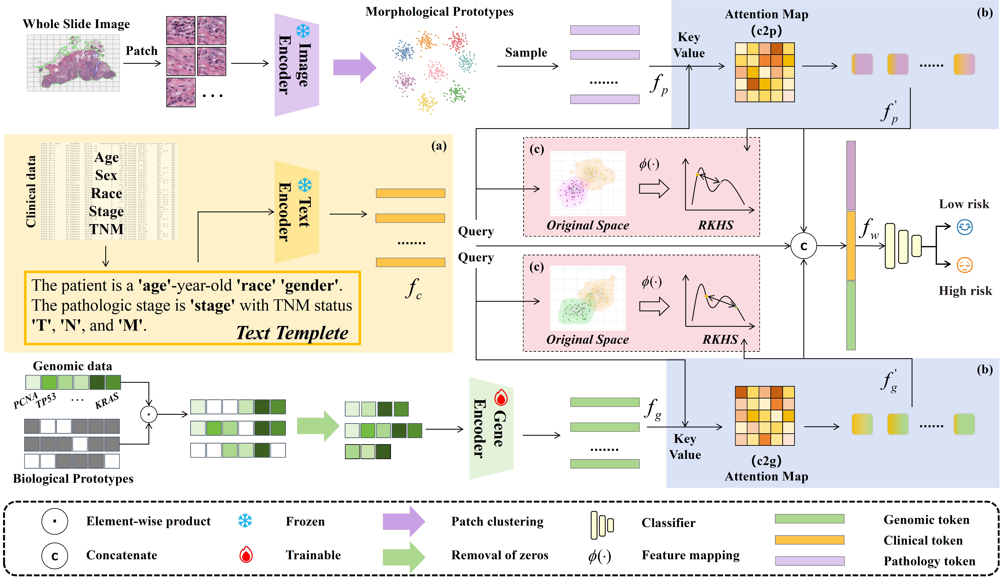

# CIGTSurv: Clinical Information Guided Tri-modal Survival Prediction with Local Prototype Association and Global Feature Alignment


[](https://arxiv.org/abs/2608.03247)



## NEWS
**2026-11-25**: We released the full version of CIGTSurv, including models, data preprocessing scripts, and training/testing scripts.

**2026-06-13**: Congratulations! Our paper is accepted by MICCAI 2026!

## Abstract

> Multimodal learning has significantly advanced survival prediction by integrating pathology images with genomic data. However, clinical information, despite its critical role in reflecting a patient’s overall health, remains underutilized due to its discrete, sparse, and low-dimensional nature. Furthermore, the inherent heterogeneity across these modalities pose significant challenges in modeling cross-modal interactions. In this paper, we propose CIGTSurv, a Clinical Information Guided Tri-modal framework for Survival prediction. Specifically, we first design a holistic text template and use pretrained foundation models to transform clinical tabular data into high-dimensional tokenized embeddings. Using clinical information as an anchor, we then introduce a dual-level interaction mechanism: 1) a local prototype association (LPA) module based on cross-attention to explicitly learn token-level correspondences between different modalities, and 2) a global feature alignment (GFA) loss based on Maximum Mean Discrepancy (MMD) to implicitly enhance cross-modal distribution consistency. Extensive experiments on five TCGA cancer cohorts demonstrate that CIGTSurv achieves state-of-the-art (SOTA) survival prediction performance.

## Installation
The code is developed and tested with the following environment:
* OS: Linux
* CUDA: 11.8
* Python: 3.10.20
* PyTorch: 2.7.1

Create a virtual environment and install the dependencies:
```shell
> conda create -n CIGTSurv python=3.10 -y
> conda activate CIGTSurv
```
Install Pytorch (CUDA 11.8):
```shell
> pip install torch==2.7.1 torchvision==0.22.1 torchaudio==2.7.1 --index-url https://download.pytorch.org/whl/cu118
```
Install other requirements:
```shell
> pip install -r requirements.txt
```
Download BioMedBERT:
> The clinical encoder loads weights from the local folder `./biomedbert`, which is not included in this repository. Download [BiomedNLP-BiomedBERT-base-uncased-abstract-fulltext](https://huggingface.co/microsoft/BiomedNLP-BiomedBERT-base-uncased-abstract-fulltext) from HuggingFace and place `pytorch_model.bin`, `config.json`, `tokenizer_config.json`, and `vocab.txt` under `./biomedbert`.

## Data preprocessing
### WSI features
1. Download diagnostic WSIs from [TCGA](https://portal.gdc.cancer.gov/)
2. Use the WSI processing tool provided by [CLAM](https://github.com/mahmoodlab/CLAM) to extract UNI pretrained 1024-dim feature for each 256 $\times$ 256 patch (20x), which is then saved as a `.pt` file per WSI (e.g., in the `UNI` folder)
3. Cluster and sample the patch features of each slide into local prototypes with KMeans (K=50 clusters, S=10 samples per cluster, i.e., 500 features per slide, seed=1):
```shell
> for d in TCGA_BLCA TCGA_BRCA TCGA_COADREAD TCGA_KIRP TCGA_LIHC; do
>     python cluster.py --input_dir <FEATURE_ROOT>/UNI/$d --output_dir <FEATURE_ROOT>/UNI_cluster_seed1/$d --K 50 --S 10 --seed 1
> done
```

### Genomic data
> The cleaned genomic profiles of each cancer type are provided in `dataset_csv/<CANCER_TYPE>_all_clean.csv.zip`, which contain mutation, copy-number variation, and RNA-seq signatures.

### Clinical data
> The structured clinical records of each cancer type are provided in `clinical_csv/<CANCER_TYPE>.csv`. During training, the records are converted into natural language prompts (e.g., "The patient is a 50-year-old black or african american female.") and encoded by BioMedBERT.

The final structure of the datasets should be as following:
```bash
DATA_ROOT_DIR/
    └──UNI/
        ├── slide_1.pt
        ├── slide_2.pt
        └── ...
    └──UNI_cluster_seed1/
        ├── slide_1.pt
        ├── slide_2.pt
        └── ...
```
`DATA_ROOT_DIR` is the base directory of a cancer type (e.g., the directory of TCGA_COADREAD), which should be passed to the model with the argument `--data_root_dir`.

## Training-Validation Splits
Splits for each cancer type can be found in the `splits/5foldcv/<CANCER_TYPE>` folder, which are randomly partitioned using 5-fold cross-validation. Each one contains `splits_{k}.csv` for k = 0 to 4.

## Running Experiments
To train CIGTSurv on a TCGA cohort, run:
```bash
CUDA_VISIBLE_DEVICES=<DEVICE_ID> python main_survival.py \
                                      --data_root_dir <DATA_ROOT_DIR>/UNI_cluster_seed1/<CANCER_TYPE> \
                                      --results_dir ./results/<CANCER_TYPE> \
                                      --split_dir ./splits/5foldcv/<CANCER_TYPE> \
                                      --csv_path ./dataset_csv/<CANCER_TYPE>_all_clean.csv.zip \
                                      --clinical_path ./clinical_csv/<CANCER_TYPE>.csv \
                                      --alpha_loss <ALPHA> \
                                      --model_type ours \
                                      --exp_code ours-1 \
                                      --mode coattn \
                                      --clinical_mode text \
                                      --apply_sig \
                                      --seed 1
```
> **Note**: `main_survival.py` hard-codes `CUDA_VISIBLE_DEVICES='1'` at the top of the file. Please modify it according to your GPU environment.

The checkpoints and `summary.csv` are saved to `<results_dir>/<exp_code>_s<seed>`.

## Acknowledgements
Huge thanks to the authors of the following open-source projects:
- [MCAT](https://github.com/mahmoodlab/MCAT)
- [CLAM](https://github.com/mahmoodlab/CLAM)
- [BioMedBERT](https://huggingface.co/microsoft/BiomedNLP-BiomedBERT-base-uncased-abstract-fulltext)
- [UNI](https://github.com/mahmoodlab/UNI)

This code is available for non-commercial academic purposes. If you have any question, feel free to email [Jing Dai](daijing@mail.dlut.edu.cn).
